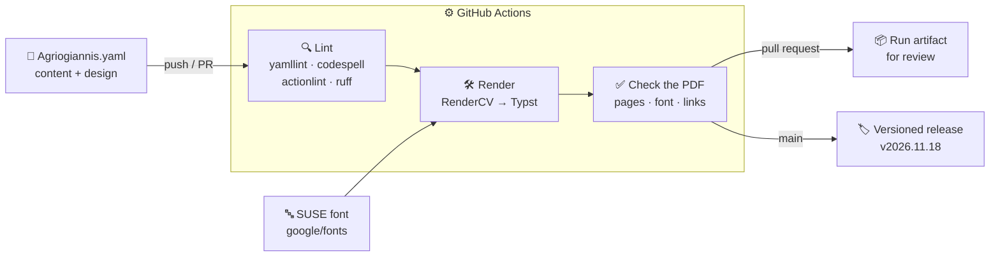

<div align="center">

# George Agriogiannis — CV

**CV as code: one YAML file in, a typeset PDF out — rebuilt by GitHub Actions on every change.**

[](https://github.com/Gagrio/CV/actions/workflows/build-cv.yml)
[](https://github.com/Gagrio/CV/releases/latest/download/Agriogiannis.pdf)
[](https://github.com/rendercv/rendercv)
[](https://typst.app)

<a href="https://github.com/Gagrio/CV/releases/latest/download/Agriogiannis.pdf"></a>
<a href="https://github.com/Gagrio/CV/releases/latest/download/Agriogiannis.pdf"></a>

<sub>The previews above are generated by the same build as the PDF, so they always match the latest version.</sub>

</div>

---

## How it works



- **Content and design live in one file.** The `cv:` section holds the text; the `design:` section holds theme, colours, fonts and spacing.
- **Every change is linted, rendered and tested** before anything is published.
- **A change to the CV on `main` publishes a new release**, versioned by date like a package (`v2026.11.18`, then `v2026.11.18.2` for a second one that day), with the PDF and page previews attached and the changes listed. Older versions stay available under [Releases](https://github.com/Gagrio/CV/releases); the [download link](https://github.com/Gagrio/CV/releases/latest/download/Agriogiannis.pdf) always serves the newest.
- **Pull requests build and test too**, without publishing — the PDF is attached to the run so a change can be reviewed before it goes live.
- **Nothing binary is stored in the repo**: fonts are fetched at build time, PDFs live in releases.

## Use it for your own CV

1. **Copy the repo** — fork it, or click **Use this template**.
2. **Write your CV.** Replace `Agriogiannis.yaml` with your own, or start fresh:
   ```bash
   pip install "rendercv[full]==2.8"
   rendercv new "Your Name"          # creates Your_Name_CV.yaml
   ```
3. **Point the workflow at it.** In `.github/workflows/build-cv.yml`, set `CV_FILE` to your file name.
4. **Pick a font.** The workflow downloads the SUSE font. To use another one, change the *Fetch SUSE font* step and `design.typography.font_family`, or delete the step and use one of the fonts that ship with RenderCV.
5. **Set your limits.** Adjust `MAX_PAGES` and `EXPECTED_FONT` at the top of the workflow.
6. **Push to `main`.** The *Build CV* workflow lints, renders, tests and publishes your PDF under **Releases**. Update the links at the top of this README to your repo and name.

> By default RenderCV names the output after `cv.name` (`name: Jane Doe` → `Jane_Doe_CV.pdf`). This CV overrides that in the `settings.render_command` block at the end of the YAML, which is why the file is `Agriogiannis.pdf`.

### What goes where

| YAML section | What it controls | Example from this CV |
|---|---|---|
| `cv.name`, `headline`, `location`, `email`, `social_networks` | Header | Name, title line, LinkedIn and GitHub links |
| `cv.sections.*` | Any section you like — the key becomes the title | `summary`, `skills`, `experience`, `projects`, `education` |
| `design.theme` | Base layout | `opal` (also: `classic`, `sb2nov`, `engineeringresumes`, `moderncv`, …) |
| `design.colors` | Name, headline, section title and link colours | Pine header, Jungle titles and links |
| `design.typography` | Font family and sizes | `SUSE`, 9.5pt body |
| `design.page` | Paper size and margins | A4, tight margins to fit two pages |
| `locale` | Language, month names | Three-letter months |
| `settings.render_command` | Output file names | `Agriogiannis.pdf` and `Agriogiannis_1.png`, `_2.png` |

The full schema is linked at the top of the YAML, so editors with the YAML language server get autocomplete and validation.

## Checks

| Stage | Tool | Catches |
|---|---|---|
| Lint | [yamllint](https://github.com/adrienverge/yamllint) | Broken or inconsistent YAML |
| Lint | [codespell](https://github.com/codespell-project/codespell) | Common typos in the CV and docs |
| Lint | [actionlint](https://github.com/rhysd/actionlint) | Mistakes in the workflow, including its shell scripts |
| Lint | [ruff](https://github.com/astral-sh/ruff) | Python errors and formatting in the test script |
| Render | RenderCV | Anything that doesn't match the RenderCV schema |
| Test | [`tests/check_cv.py`](tests/check_cv.py) | The CV growing past `MAX_PAGES`, text falling back to another font when the font is missing, a wrong name in the header, lost hyperlinks, missing previews |

The page limit and font are set at the top of the workflow (`MAX_PAGES`, `EXPECTED_FONT`). [Dependabot](.github/dependabot.yml) keeps the actions up to date.

## Build locally

```bash
pip install "rendercv[full]==2.8"

mkdir -p fonts
base=https://raw.githubusercontent.com/google/fonts/main/ofl/suse
curl -fsSL -o 'fonts/SUSE[wght].ttf'        "$base/SUSE%5Bwght%5D.ttf"
curl -fsSL -o 'fonts/SUSE-Italic[wght].ttf' "$base/SUSE-Italic%5Bwght%5D.ttf"

rendercv render Agriogiannis.yaml
```

The PDF, PNG previews, Markdown and HTML versions land in `rendercv_output/`. To run the same checks as CI:

```bash
pip install yamllint codespell pypdf pdfminer.six
yamllint . && codespell --skip .git .
python tests/check_cv.py Agriogiannis.yaml rendercv_output
```

## Design

| | Colour | Used for |
|---|---|---|
|  | Pine `#0c322c` | Name, headline, contact line |
|  | Jungle `#30ba78` | Section titles and links |

- **Theme:** Opal, with Harvard-style centred section titles
- **Font:** [SUSE](https://fonts.google.com/specimen/SUSE) (SIL Open Font License)
- **Layout:** A4, two pages, 9.5pt body text

## Repository layout

```text
.
├── Agriogiannis.yaml               # the CV: content, design, output names
├── tests/check_cv.py               # checks on the rendered PDF
├── .github/
│   ├── workflows/build-cv.yml      # lint → render → test → release
│   └── dependabot.yml              # keeps the actions current
├── .yamllint.yaml                  # YAML lint rules
├── .gitignore                      # fonts/ and rendercv_output/ stay local
└── README.md
```

## Credits

Built with [RenderCV](https://github.com/rendercv/rendercv) and [Typst](https://typst.app). The setup and workflow are free to reuse; the CV content is mine.
